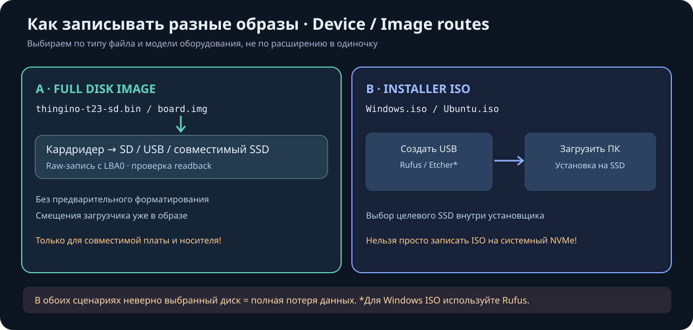
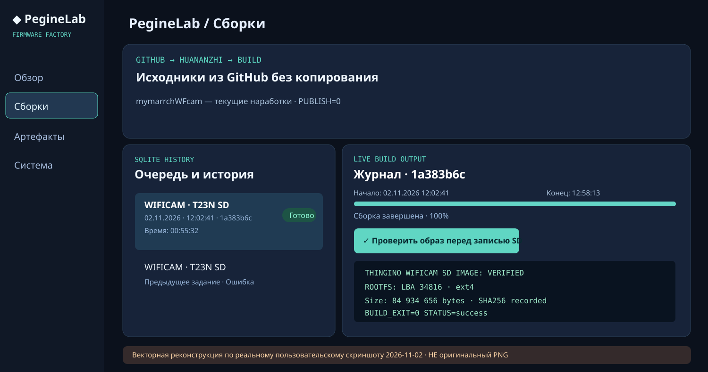
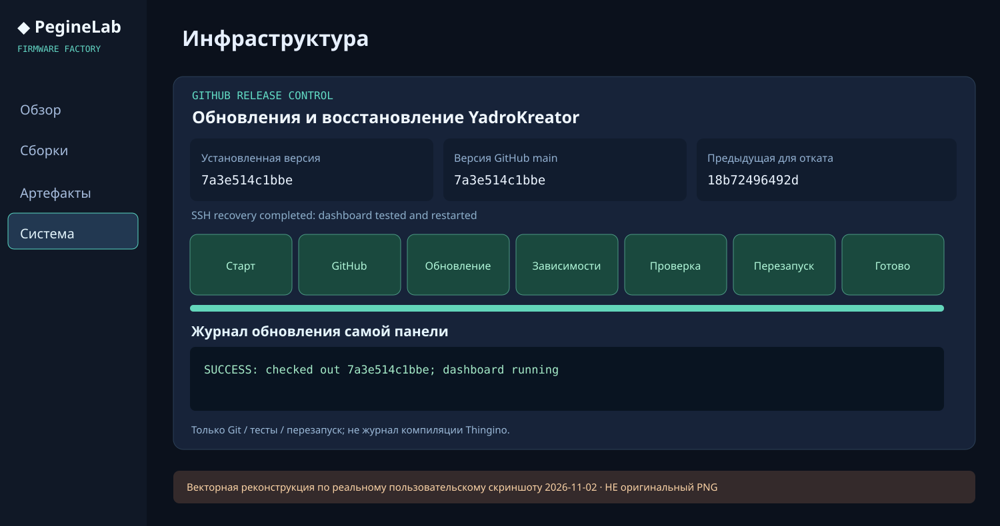

# PegineLab YadroKreator — Firmware & Kernel Factory

**Самостоятельная станция сборки Linux-ядер и прошивок на Ubuntu 24.04.**

**Independent Linux kernel and firmware build station for Ubuntu 24.04.**

Проект полностью отделён от исходников камеры `wificam_T23N`. Веб-интерфейс, SQLite, systemd-управление, документация и макеты принадлежат этому репозиторию. WIFICAM — лишь первый внешний профиль сборки.

## Запуск и остановка веб-панели / Start and stop the dashboard

**Huananzhi Ubuntu:** `bash start.sh` запускает только `peginelab-factory.service`,
`bash stop.sh` останавливает только веб-панель, команда
`bash scripts/project-control.sh status` показывает её состояние.
Сборки в отдельных `peginelab-build-*` unit **не отменяются** остановкой панели;
для них есть собственная кнопка остановки в разделе «Сборки».

**Windows PowerShell:** `.\start.ps1` / `.\stop.ps1` управляют той же
службой Ubuntu по SSH `user@192.168.0.100`; Windows не запускает вторую
копию сервера. Пароль вводится OpenSSH при необходимости.

Полная инструкция: [RU](docs/PROJECT_CONTROL_RU.md) ·
[EN](docs/PROJECT_CONTROL_EN.md). После остановки сайт на порту 62404
**не сможет включить себя сам**: для повторного старта нужен терминал или
PowerShell SSH.

## Первый профиль / First build target

- **WIFICAM T23N**: внешний checkout `musikfed/wificam_T23N` и Thingino на том же Linux-хосте.
- Последующие профили Linux kernel, ARM, MIPS, RISC-V можно добавлять без изменений в репозиторий камеры.
- Web server: **Waitress + Flask**, native Ubuntu build on ext4, **no Docker**.
- Port: **192.168.0.100:62404** (внутренний IP сервера владельца).
- Доступ через существующую VPN/LAN **без веб-пароля**, по выбору владельца.
- История и статусы сборок в SQLite WAL; фоновые задачи запускает systemd.

## Проверенный образ и новые кандидаты / Baseline versus build candidates

- Аппаратно загруженный `wificam_T23N/Thingino/thingino-t23-sd.bin` — неизменяемая ссылка на `0.1_test` (**SD boot подтверждён, старый Web UI не исправлен**).
- При обычной сборке в панели (`PUBLISH=0`) новый `out/candidate-sd/thingino-t23-sd.bin` считается **непроверенным кандидатом** до испытаний на реальной камере.
- При локальном `local/wifi.env` Wi-Fi ключ встроен в `out/private-sd/thingino-t23-sd.bin`; такие образы не публикуются.
- Панель показывает наличие и SHA256 всех трёх вариантов отдельно. Новый SD image нельзя автоматически объявлять релизом.

## Git-подгрузка и деплой без копипаста

YadroKreator напрямую загружает `musikfed/wificam_T23N` из GitHub для каждой сборки и закрепляет source SHA в отдельном Git worktree. В веб-панели выберите `mymarrchWFcam` либо `main`; `PUBLISH=0` не заменяет аппаратный эталон `0.1_test`. Саму панель обновляет `deploy.sh`, а `bootstrap.sh` выполняет первичную настройку Huananzhi. Опциональный systemd timer включается явно.

- [Настройка и обновление из Git / RU](docs/GIT_DEPLOY_RU.md)
- [Git source and deployment / EN](docs/GIT_DEPLOY_EN.md)

## Оповещения и откат веб-панели / Updates & rollback

Раздел **Система** сравнивает установленный SHA с GitHub `main`, показывает уведомление о новой версии и позволяет вручную **Обновить** либо **Откатить** на предыдущую успешно сохранённую ревизию. История и образы WIFICAM не затрагиваются. Операции блокируются на время сборки. Таймер проверяет обновления, но больше не устанавливает их автоматически.

## Проверка SD, ETA и графический генератор / Preflight, ETA & layout map

После завершения сборки `t23n_sd` выберите задание и нажмите **«Проверить образ перед записью SD»**. Без записи на карту: SHA256, MBR, T23N MSPL на LBA34, FAT16/uImage и ext4. Динамический SVG строится по байтам готового образа. Проверка не заменяет аппаратный тест. В истории показываются старт, финиш, длительность и ориентировочный прогресс по прошлым успешным сборкам; первая сборка отображается без фиктивных процентов.

- [Проверка перед записью / RU](docs/PREFLIGHT_RU.md) · [EN](docs/PREFLIGHT_EN.md)
- [Схема и дерево проекта / RU](docs/ARCHITECTURE_RU.md) · [EN](docs/ARCHITECTURE_EN.md)
- [Изменение кода и выпуск релиза / RU](docs/MODIFY_RELEASE_RU.md) · [EN](docs/MODIFY_RELEASE_EN.md)
- [SVG: графика конвейера](docs/previews/pipeline-architecture.svg) · [Экран проверки (макет)](docs/previews/preflight-dashboard.svg)

## Прогресс обновлений и скачивание SD / Update progress & secure SD export

В разделе **Система** показаны этапы обновления: старт, GitHub, установка, зависимости, тесты, перезапуск и завершение. После успешного перезапуска панель обновится в браузере автоматически; доступен откат на предыдущую успешную версию.

В разделе **Артефакты** кнопка **«Скачать образ .img»** доступна сразу после успешной сборки T23N; при скачивании сервер самостоятельно проверяет **SHA256 и структуру уже готового SD-образа**. Новая компиляция ядра не запускается. Предварительная кнопка «Проверить SD» остаётся для просмотра структуры. Без терминала или ввода ID: одно нажатие в «Артефакты». Экспорт ограничен доверенной LAN `192.168.0.0/24` и loopback; без веб-логина любой клиент разрешённой сети сможет скачать образ с Wi-Fi настройками. Не выставлять 62404 в интернет.

- [Скачать и записать SD / RU](docs/SD_DOWNLOAD_RU.md)
- [Secure firmware download and flashing / EN](docs/SD_DOWNLOAD_EN.md)

## Раздельные журналы / Separate updater and firmware logs

- **Система → Журнал обновления самой панели:** этапы GitHub/deps/tests/restart, отдельный `factory-state/update-logs/<operation>.log`, ошибки с концом traceback; никакого вывода компиляции Thingino.
- **Сборки → Консоль сборки:** журнал WIFICAM/ядра. При обновлении страницы завершённого задания отображаются **последние 64 КиБ архива**, а не имитация новой компиляции. Полный журнал открывается по явной кнопке «Показать полный архив».
- Если старая панель не обновляется (и новый графический индикатор ещё не появился), есть [SSH-инструкция восстановления](docs/UPDATER_RECOVERY_RU.md) без изменения прошивки, SD или SQLite.

## SD / USB / SSD — запись образов и установка ОС

В репозитории есть отдельное руководство, чтобы не путать **полный образ прошивки платы (.img/.bin)** с **установочным ISO Windows/Linux**:

- [RU: SD для мини-устройств, USB для ОС, SSD/NVMe и 4 программы записи](docs/MEDIA_FLASHING_RU.md) · [EN](docs/MEDIA_FLASHING_EN.md)
- [Карта T23N: MBR LBA0, MSPL LBA34, BOOT LBA2048, ROOTFS LBA34816](docs/previews/t23n-sd-layout.svg)
- [Схема «ISO → USB-установщик → SSD/NVMe»](docs/previews/os-installer-flow.svg)

## Галерея работающей панели · 02.11.2026

По двум скриншотам Huananzhi собраны **векторные реконструкции**: они показывают реальные наблюдавшиеся состояния (сборка `1a383b6c` — **00:55:32**, апдейт панели `7a3e514c1bbe`) и **чётко обозначены как неоригинальные PNG**. Личные исходные PNG публикуются только после проверки данных.

[Галерея, происхождение изображений и инструкция по публикации исходных скриншотов](docs/SCREENSHOTS_RU.md)

## Документация

- [Русская инструкция](docs/README_RU.md)
- [English guide](docs/README_EN.md)
- [Превью главной панели](docs/previews/factory-overview.svg)
- [Превью страницы сборок](docs/previews/factory-builds.svg)

**Сетевая безопасность.** Веб-панель управляет запуском процессов и не содержит собственной аутентификации. Адрес 192.168.x.x **не** гарантирует изоляцию: используйте доверенную VPN, изолированную LAN и/или firewall. **Не публикуйте TCP 62404 в Интернет.** Для других установок можно использовать TLS и внешнюю аутентификацию.

**Build safety:** сборщик не публикует личные SD-образы с Wi-Fi ключом в GitHub (`PUBLISH=0`); перед скачиванием выполняется preflight, а приватный файл доступен только из настроенной доверенной LAN. Это не персональная авторизация; обычный HTTP не шифрует трафик — используйте защищённую сеть/VPN или SCP. CI запрещает хранить `.img`/`.bin` в Git. Прошивку необходимо испытать на устройстве.

© PegineLab. Сторонние компоненты сохраняют собственные лицензии и авторство.
