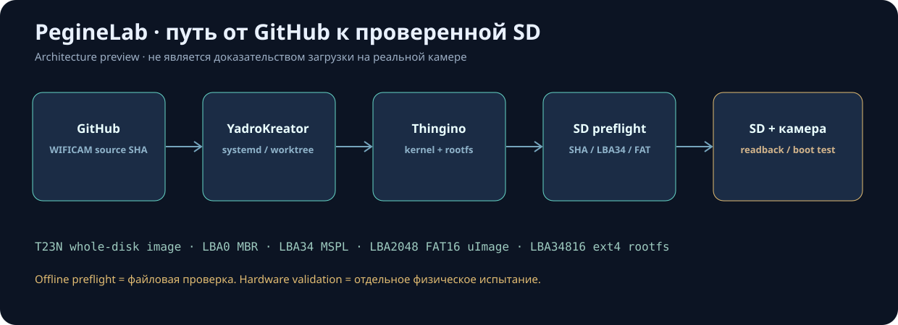

# PegineLab / YadroKreator architecture and repository map

YadroKreator is an **orchestrator + monitoring dashboard**, independent of the camera source repository. Huananzhi Ubuntu 24.04 runs the dashboard at the LAN-only address \`192.168.0.100:62404\`.

\`\`\`text
YadroKreator/
├── app.py                    Flask API and registered actions
├── core.py                   SQLite WAL, job times and state
├── worker.py                 systemd build job (pinned external source)
├── git_sources.py            allowlisted branch fetch and Git worktree
├── build_metrics.py          elapsed time, historical ETA, capped estimate
├── artifact_checks.py        read-only T23N image preflight and live SVG
├── update_manager.py         dashboard Git updates and rollback
├── bootstrap.sh/install.sh   initial installation / systemd
├── deploy.sh                 update/check/rollback the dashboard only
├── templates/index.html      frontend semantic structure
├── static/app.js/app.css     UI, live status, image verification button
├── tests/                    offline unit/integration tests
├── .github/workflows/        CI
└── docs/previews/            explicit SVG mockups and architecture diagrams
\`\`\`

External Huananzhi state is under \`/1tbdisk/PegineLab/\`: \`build/thingino-firmware\`, \`build/git-cache\`, \`build/jobs/<job-id>/wificam_T23N\`, and \`factory-state/{factory.sqlite3,logs/,validation/,updates.json}\`. Local \`projects/wificam_T23N/local/wifi.env\` is private and must never be committed.

For the T23N profile, the dynamic SVG map reflects image bytes: MBR LBA0, MSPL LBA34, BOOT FAT16/uImage at LBA2048 and ext4 ROOTFS at LBA34816. These offsets are NOT universal for other boards. The diagram depicts storage layout only; it does not enumerate every compiled Linux driver or prove physical boot.

Separate release gates: Git CI pass; structural image/SHA pass; physical SD write/readback pass; camera hardware boot/SSH/web/RTSP/PTZ pass.

Additional SVG design previews: [Overview](previews/factory-overview.svg), [Builds](previews/factory-builds.svg), [New preflight screen](previews/preflight-dashboard.svg). They are illustrations **not real system screenshots**; capture real browser screenshots separately after removing sensitive details.

See [preflight verification](PREFLIGHT_EN.md) and [editing/release guide](MODIFY_RELEASE_EN.md).
