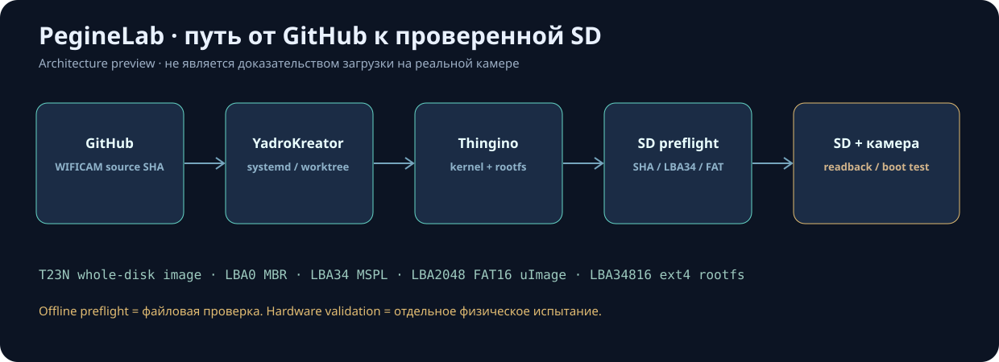

# Архитектура PegineLab / YadroKreator

YadroKreator — **орchestrator и наблюдательная панель**, не исходники самой камеры. Веб-панель на Huananzhi Ubuntu 24.04 (\`192.168.0.100:62404\`) управляет кодом из внешнего \`musikfed/wificam_T23N\` и Thingino. Другие ядра/прошивки потребуют отдельных профилей.

## Карта потока

\`\`\`mermaid
flowchart LR
  A[GitHub WIFICAM branch] --> B[YadroKreator Git fetch / pinned SHA]
  B --> C[Systemd job, separate worktree]
  D[Thingino pinned checkout] --> C
  C --> E[Kernel + rootfs + web UI]
  E --> F[Whole-disk SD image]
  F --> G[Read-only profile preflight]
  G --> H[Manual SD writer + readback]
  H --> I[Physical camera / recovery tests]
\`\`\`

## Дерево проекта

\`\`\`text
YadroKreator/
├── app.py                 # Flask API, JSON /api/...; никакой записи SD
├── core.py                # SQLite WAL jobs, created/started/finished
├── worker.py              # задача systemd: git fetch -> shell build
├── git_sources.py         # allowlist Git веток, source SHA, isolated worktree
├── build_metrics.py       # длительность, историческая оценка ETA
├── artifact_checks.py     # ТОЛЬКО чтение образа T23N, SHA и LBA / SVG
├── update_manager.py      # обновление и безопасный откат только панели
├── bootstrap.sh           # первоначальная установка Thingino + dashboard
├── deploy.sh              # проверить/обновить/откатить код панели
├── install.sh             # python venv + Waitress + systemd user service
├── setup-update-timer.sh  # только проверять GitHub, не ставить автоматически
├── templates/index.html   # разметка вкладок и поля панели
├── static/app.js          # данные API, таймер, кнопка проверки и схема
├── static/app.css         # стили и анимация; без команд shell
├── tests/                 # offline unit tests в GitHub Actions
├── .github/workflows/     # CI синтаксиса, API и валидатора
└── docs/
    ├── ARCHITECTURE_*.md
    ├── MODIFY_RELEASE_*.md
    ├── PREFLIGHT_*.md
    ├── GIT_DEPLOY_*.md
    └── previews/          # SVG, явно помеченные как дизайн/пример
\`\`\`

Каталоги **вне GitHub**, на сервере:

\`\`\`text
/1tbdisk/PegineLab/
├── projects/YadroKreator/               # main веб-панели
├── projects/wificam_T23N/                # отдельный проект прошивки
│   └── local/wifi.env                    # PRIVATE, не публиковать
├── build/thingino-firmware/              # pinned upstream Buildroot
├── build/git-cache/wificam_T23N.git      # bare Git cache
├── build/jobs/<job-id>/wificam_T23N/     # отдельный pinned SHA
│   ├── out/private-sd/thingino-t23-sd.bin
│   ├── out/candidate-sd/thingino-t23-sd.bin
│   └── Thingino/thingino-t23-sd.bin       # ветка mymarrchWFcam
└── factory-state/
    ├── factory.sqlite3                   # Jobs / statuses / timestamps
    ├── logs/<job-id>.log                  # процесс компиляции
    ├── validation/<job-id>.json           # SHA, LBA, статус preflight
    └── updates.json                       # статус обновления панели
\`\`\`

## Что показывает генератор схемы

Кнопка **«Проверить образ перед записью SD»** формирует карту из фактических байтов конкретного \`thingino-t23-sd.bin\`: MBR, T23N MSPL LBA34, BOOT FAT16/uImage и ROOTFS ext4. Это **не** автоматический граф всех драйверов Linux, не \`menuconfig\`, не представление исходных C-файлов и не физическая проверка. Для будущих ядер (ARM/RISC-V/другие MIPS) потребуется иной проверенный разбор образа.

Исходный full-disk образ T23N записывается **с LBA0**. Перенос MSPL на LBA34 уже происходит **при сборке образа**, не при записи его на SD.

## Основные ограничения / безопасность

- Панель не имеет встроенной аутентификации; разрешать 62404 только доверенным LAN/VPN-клиентам.
- Штатные кнопки не пишут SD и не управляют произвольным shell. Приватный \`wifi.env\` не отправляется в GitHub или браузер.
- Проверка кода (GitHub Actions), проверка файла (SHA/разделы), проверка записи на SD (readback) и проверка камеры (hardware) — четыре разные ступени.
- Не удалять \`release/0.1_test\` и его SHA; не объявлять новую сборку аппаратно испытанной до загрузки на камере.

## Скриншоты, изображения и документы

- [Обзор — графический макет](previews/factory-overview.svg)
- [Сборки — графический макет](previews/factory-builds.svg)
- [Новый экран проверки — графический макет](previews/preflight-dashboard.svg)
- [Схема конвейера — SVG](previews/pipeline-architecture.svg)

Файлы в \`docs/previews/\` — **векторные иллюстрации интерфейса**, не фактические скриншоты live Huananzhi. Для реального снимка откройте вкладку браузера, нажмите \`PrintScreen\`, проверьте отсутствие персональных данных (Wi-Fi, токены, MAC/IP при публикации) и сохраните его локально. Не коммитьте приватные изображения с сервера.
