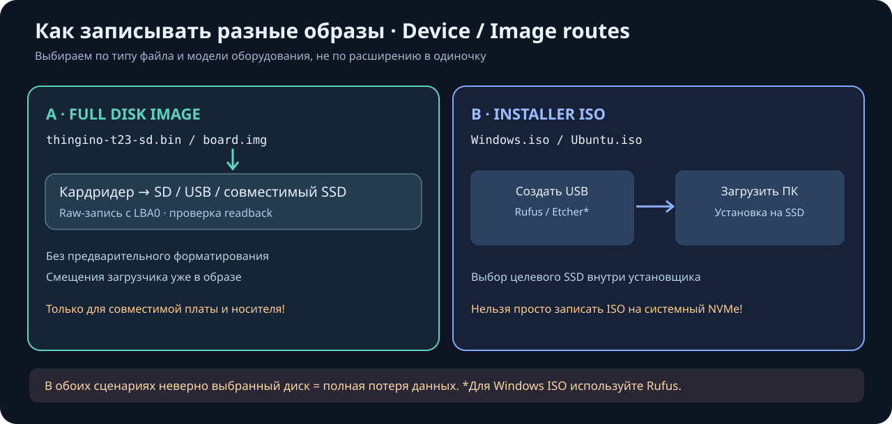
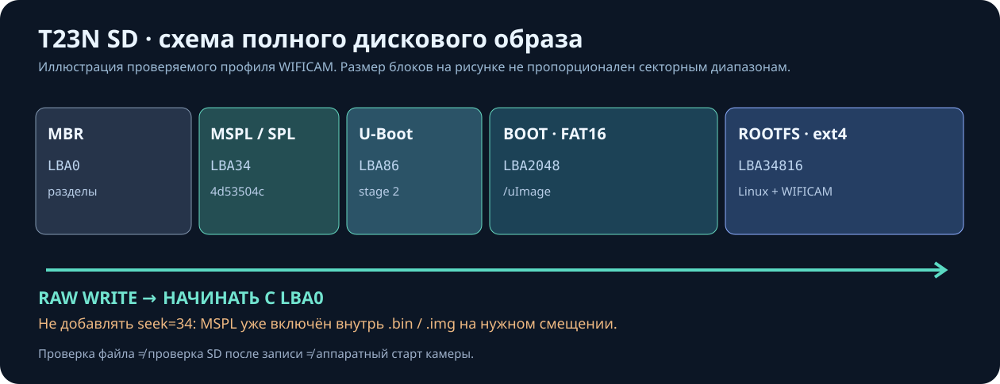
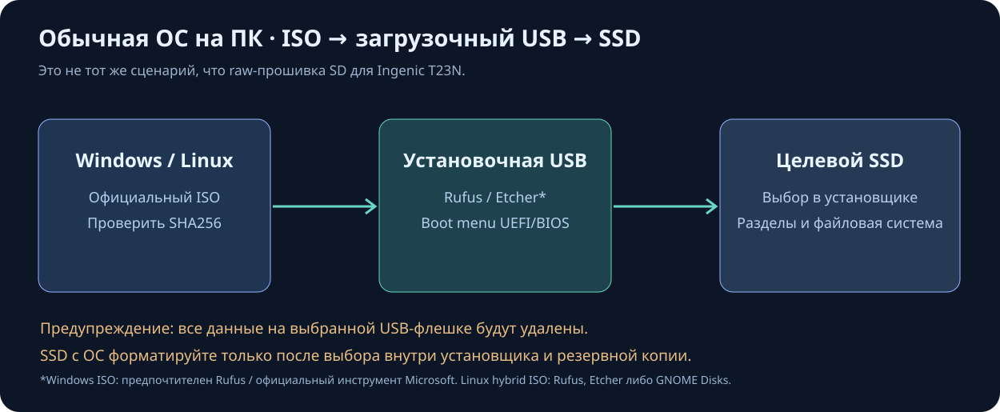

# Image flashing: mini devices, SBC storage, OS installer USBs and SSDs

**Destructive warning:** flashing an image overwrites the selected **whole device**, potentially destroying data. Verify physical device model, interface, size, mount points and backups first. YadroKreator currently **does not** write SD/SSD media itself.

## Choose the correct workflow

| Input | Target | Correct action |
| --- | --- | --- |
| Raw whole-disk **.img/.bin** with partition table | T23N or explicitly compatible embedded board | Flash entire device **starting at LBA0**; embedded bootloader offsets are already in the image |
| **.img/.img.xz** for an SBC | Raspberry Pi / board-matched storage (SD, USB or supported NVMe) | Manufacturer's imager or Etcher; confirm board compatibility and boot order |
| Linux hybrid live/install **.iso** | Standard PC | Create **bootable USB** first, boot the PC, then use installer to install onto chosen SSD/NVMe |
| Windows installer **.iso** | Standard PC | Use Rufus/official Microsoft media tool to prepare USB, then use Windows installer to select internal SSD |
| **uImage/rootfs.ext4** or kernel-only file | Board-specific | Not a whole disk; use a board-specific partition/build/install procedure |

**T23N WIFICAM**: build branch \`mymarrchWFcam\` in YadroKreator, finish the job, run **Check image before writing SD**, then use the token-protected **Download .img** from Artifacts or SSH/SCP. A private image may contain Wi-Fi credentials: do not publish it. The read-only check verifies SHA256, MBR, MSPL at **LBA34**, FAT16 BOOT at **LBA2048** containing \`uImage\`, and ext4 ROOTFS at **LBA34816**. The **whole-disk** image is always flashed at **LBA0**: do not add \`seek=34\`.

For Windows SD writing, use [Etcher](https://etcher.balena.io/) or a supported raw/DD write mode in [Rufus](https://rufus.ie/). No prior formatting is needed; ignore Windows prompts to format ext4. For Linux/Huananzhi, run the read-only command:

\`\`\`bash
lsblk -o NAME,PATH,SIZE,MODEL,TRAN,RM,TYPE,FSTYPE,MOUNTPOINTS
\`\`\`

Only after confirming a removable USB reader, invoke the trusted WIFICAM job's \`scripts/write_thingino_wificam_sd.sh\` with the correct **whole-disk path**, followed by the **absolute path to the verified image**. The script requires confirmation and does a full SHA256 device readback. It is **not intended for internal SSD/NVMe**. Test boot, SSH, Web :8090, video, Wi-Fi and PTZ on actual hardware before declaring release success. Preserve the \`0.1_test\` recovery SD.

**Raspberry Pi and other mini PCs**: use board-specific images and boot instructions. Raspberry Pi Imager supports *Choose Device → Choose OS (Use Custom if appropriate) → Choose Storage → Write*. The T23N image is not Raspberry Pi compatible. See [Raspberry Pi's official documentation](https://www.raspberrypi.com/documentation/computers/getting-started.html).

**PC installer ISO**: create a USB installer first; **do not raw-write an arbitrary Windows/Linux ISO onto the internal system SSD**. Boot the installer through the PC's BIOS/UEFI boot menu, then select target drive inside the OS installer. Match Rufus UEFI/GPT vs legacy BIOS/MBR settings to the machine. Raw direct images to SSD are safe only when their publisher explicitly documents that target.

## Useful applications (official sources)

| App | Host platform | Best fit |
| --- | --- | --- |
| [balenaEtcher](https://etcher.balena.io/) / [docs](https://etcher-docs.balena.io/) | Windows, Linux, macOS | Raw SD/USB whole-image flash + validation |
| [Rufus](https://rufus.ie/) | Windows | Installer USB from Windows/Linux ISO; supported disk images |
| [Raspberry Pi Imager](https://www.raspberrypi.com/software/) | Windows, Linux, macOS | Raspberry Pi OS, compatible custom SBC images |
| [GNOME Disks](https://apps.gnome.org/DiskUtility/) | Linux | Restore supported disk image to a selected removable device |

Do not claim that a green checksum check verifies actual SD boot. Separate gates are: Git CI → image structure/SHA → SD write/readback → actual device boot and functional testing. The reverse path is a retained known-good image and a second SD card.

Read the [full Russian illustrated guide](MEDIA_FLASHING_RU.md), [private download guide](SD_DOWNLOAD_EN.md), [verified image checks](PREFLIGHT_EN.md), [gallery of user-supplied screen reconstructions](SCREENSHOTS_RU.md).
