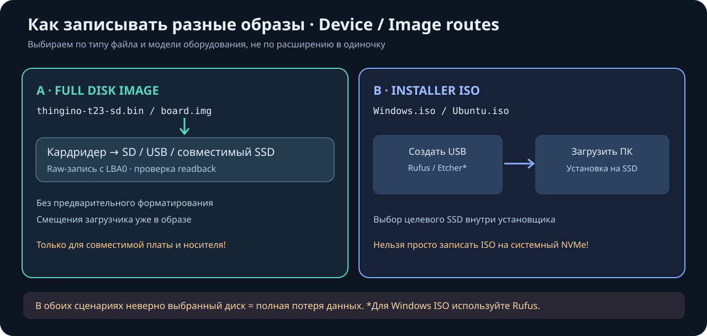
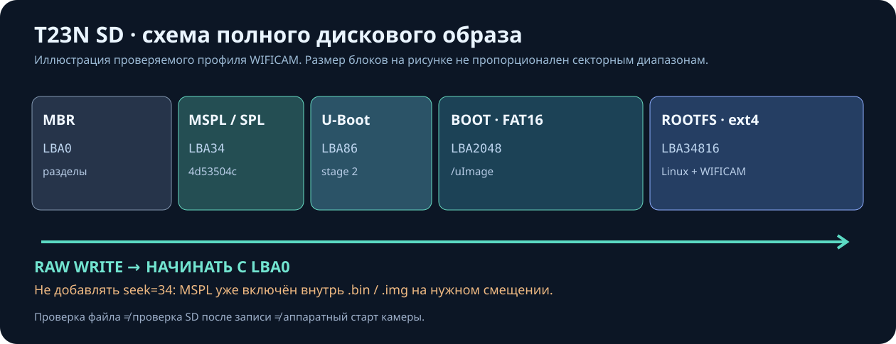
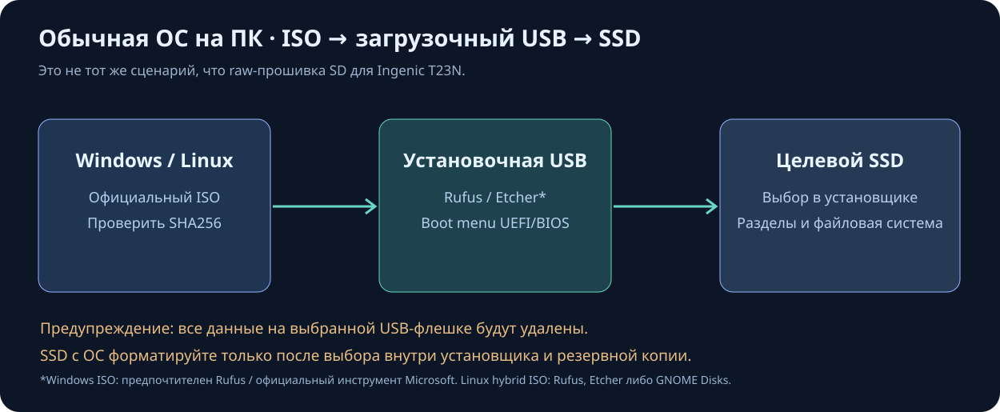

# Запись образов: SD для мини-устройств, USB для установщиков ОС и диски SSD/NVMe

> **Критично:** выбор неправильного устройства полностью удалит данные с SSD/NVMe, USB или SD. Сначала делайте резервную копию и проверяйте имя, размер, тип, интерфейс и точку монтирования носителя. Это инструкция, а не кнопка записи в YadroKreator: **панель сама носители не форматирует и не прошивает**.

## 1. Сначала выяснить тип файла и устройство

| Образ | Целевая аппаратура | Как правильно установить |
| --- | --- | --- |
| **Whole-disk \`.img\` / \`.bin\`** с MBR/GPT и загрузчиком | T23N, другие SoC, SBC, роутеры | Raw-запись **от сектора 0** на целую SD/USB/eMMC; **никакого добавочного смещения** |
| **SBC OS \`.img\`, \`.img.xz\`** | Raspberry Pi и другие совместимые мини-ПК | Утилита производителя либо Etcher/Imager, на подходящий SD/USB/SSD, если плата умеет с него загружаться |
| **Linux hybrid installer/live \`.iso\`** | Обычный ПК x86-64 / UEFI/BIOS | Из ISO подготовить загрузочную USB-флешку, затем запустить установщик ОС и выбрать целевой SSD/NVMe **в установщике** |
| **Windows installer \`.iso\`** | Обычный ПК | Rufus (Windows) или официальное средство Microsoft → загрузочный установочный USB → установщик Windows на нужный SSD/NVMe |
| **\`rootfs.ext4\`, \`uImage\`, \`zImage\`, \`vmlinuz\`** без таблицы разделов | Только известный профиль платы | Это **не целый диск**. Не записывать как \`.img\` целиком: нужен профильный загрузчик/расположение разделов |

**Не путайте два процесса:** создание установочной USB-флешки и установку ОС на внутренний SSD. Raw-запись файла с таблицей разделов сразу на диск допустима **только** когда этот файл официально предназначен для такого устройства.

## 2. Запись WIFICAM T23N на SD (наш реальный проект)

1. **Сборка:** в YadroKreator выбрать \`mymarrchWFcam\` и дождаться \`Готово\`. Успешное задание \`1a383b6c...\` на скриншоте от 2026-11-02 длилось **00:55:32**; это конкретный пример, не гарантированное время будущих сборок.
2. **Проверка:** выбрать завершённое задание → **«Проверить образ перед записью SD»**: реальный SHA256, MBR, сигнатура MSPL на LBA34, FAT16/uImage p1 с LBA2048, ext4 p2 с LBA34816. **Зелёный статус не означает успешный запуск камеры.**
3. **Скачать:** в «Артефакты» после успешной сборки сразу нажать **«Скачать образ .img»**. Структура проверяется автоматически на готовом файле; повторного запуска часовой компиляции нет. Никаких SSH-кодов и длинных ID: скачивание по одной кнопке из доверенной LAN. Панель пока без веб-авторизации, поэтому другие устройства разрешённой сети тоже могут получить приватный образ с Wi-Fi настройками. Не открывайте порт 62404 в интернет; используйте защищённую LAN/VPN либо SCP.
4. **Windows:** в Etcher открыть \`.img\` → выбрать **именно SD-карту в кардридере** → записать → дождаться проверки → безопасно извлечь. В Rufus используйте raw/DD-запись, если такая опция предложена для этого файла. Изменять расширение \`.bin\` на \`.img\` допустимо **только для реально полного raw-образа**; это не преобразование формата.
5. **Ubuntu:** сначала безопасная команда проверки:
   \`\`\`bash
   lsblk -o NAME,PATH,SIZE,MODEL,TRAN,RM,TYPE,FSTYPE,MOUNTPOINTS
   \`\`\`
   При гарантированно определённой съёмной SD через USB-кардридер используйте **только** проверенный скрипт из работы WIFICAM:
   \`\`\`bash
   # Пример аргументов; не запускать до проверки устройства и полного пути!
   sudo sh /1tbdisk/PegineLab/build/jobs/ПОЛНЫЙ_ID_ЗАДАНИЯ/wificam_T23N/scripts/write_thingino_wificam_sd.sh \
     /dev/ПРОВЕРЕННАЯ_SD \
     /1tbdisk/PegineLab/build/jobs/ПОЛНЫЙ_ID_ЗАДАНИЯ/wificam_T23N/out/private-sd/thingino-t23-sd.bin
   \`\`\`
   Скрипт проверяет тип диска/USB/RM, сигнатуры, размер, запрашивает ручное подтверждение и **читает записанный образ обратно** для сверки SHA256. Не использовать скрипт для внутренних SSD, других SoC и обычных ISO.
6. **Первый запуск:** отключить питание камеры → вставить SD → включить → проверить boot, SSH, Wi-Fi, Web UI \`:8090\`, видеопоток, CGI/API, PTZ, повторный старт. Эталон \`0.1_test\` не удалять.

**Смещения нашего T23N:** MBR **LBA0**, MSPL **LBA34**, U-Boot proper **LBA86**, BOOT/FAT16 **LBA2048**, ROOTFS/ext4 **LBA34816**. Образ содержит эти байты **внутри себя**. Записывать полный файл надо **от LBA0**. Нельзя применять \`seek=34\` к готовому full-disk образу. Эти числа **не универсальны** для Raspberry Pi, других Ingenic, ARM, x86 и т. д.

SD отдельно форматировать **не нужно**: raw-запись заменяет разметку и разделы. Если Windows предложит отформатировать ext4 — **отказать**. Неразмеченный остаток SD можно расширять/размечать **после аппаратной проверки**, отдельно от первой записи.

## 3. Мини-компьютеры и другая встраиваемая аппаратура

У Raspberry Pi и других SBC есть собственные загрузчики, EEPROM, boot-order и схемы разметки. Выбирайте **точную модель**, разрешённый носитель (SD, USB SSD, NVMe через адаптер) и образ с официальной страницы устройства/дистрибутива.

**Raspberry Pi Imager:** *Choose Device → Choose OS → Choose Storage → Write*. Для своего совместимого образа можно использовать *Use Custom*. Не выключайте исключение системных дисков без необходимости. Raspberry Pi Imager не делает произвольный \`T23N.bin\` совместимым с Raspberry Pi.

**balenaEtcher:** *Flash from file → Select target → Flash → Validate*. Подходит для целых образов устройства; предварительная разметка не нужна. Проверка записи не гарантирует совместимость образа с платой.

**GNOME Disks** в Linux: выберите съёмное устройство по модели → меню ⋮ → *Restore Disk Image…* → выберите поддерживаемый образ → подтвердите. Полностью перезапишет выбранное устройство.

## 4. Создание установочной USB для Windows/Linux, установка ОС на SSD/NVMe

**Windows через Rufus:** взять оригинальный ISO → **Device** (USB, а не системный SSD) → **Boot selection** (ISO) → подобрать GPT/UEFI или MBR/BIOS в соответствии с целевым ПК → Start → загрузить ПК с USB через boot menu → уже в установщике выбрать нужный целевой диск и разделы. Не нужно raw-записывать ISO напрямую на внутренний NVMe.

**Linux desktop ISO:** подготовить загрузочную USB через Etcher/Rufus или GNOME Disks (если ISO гибридный и поддерживается) → загрузиться с USB → выбрать установку ОС → проверить список внутренних дисков → установить на назначенный SSD/NVMe. На диске с важными данными сначала сделать резервную копию, отключить другие диски по возможности.

**Готовый raw \`.img\` для специализированного x86 диска** — отдельный случай: запись напрямую на целевой SSD допустима только если производитель образа указывает такой сценарий. Нельзя применять профиль T23N или его скрипт.

## 5. Программы (проверенные официальные источники)

| Программа | Система | Типичная задача | Официальный сайт |
| --- | --- | --- | --- |
| **balenaEtcher** | Windows / Linux / macOS | whole-disk SD/USB, проверка после записи | https://etcher.balena.io/ — документация https://etcher-docs.balena.io/ |
| **Rufus** | Windows | установочные USB из ISO, поддерживаемые raw-образы | https://rufus.ie/ |
| **Raspberry Pi Imager** | Windows / Linux / macOS | совместимые образы Raspberry Pi / custom OS | https://www.raspberrypi.com/software/ |
| **GNOME Disks** | Linux | восстановление образа диска на устройство | https://apps.gnome.org/DiskUtility/ |

**Проверяйте:** источник загрузки, SHA256 если опубликован, правильную модель носителя, отсутствие ошибок записи, режим BIOS/UEFI либо SD-boot, поведение устройства при повторном старте. При использовании Windows подмену скачанного ISO/IMG и ненадёжные «переупаковщики» избегать.

## 6. Матрица выпуска и восстановления

| Стадия | Подтверждение | Чего она **не** подтверждает |
| --- | --- | --- |
| CI в GitHub | исходники/тесты программы | запуск на вашей T23N |
| Image preflight | SHA256 и структура SD-файла | запись на реальную карту |
| Flash/readback | совпадение записанных байтов | успешную загрузку камеры |
| Hardware boot | запуск на реальном устройстве, Web/SSH/RTSP/PTZ | работу других ревизий устройства |
| Release | сохранённый SHA, хеш, список проверок и известные ограничения | совместимость со всеми платами |

Резерв: сохранить старый аппаратно загрузившийся \`0.1_test\`. Записывать на вторую SD для регрессии; не менять рабочую карту до подтверждения новой.

## Скриншоты панели и графические инструкции

[Галерея состояния YadroKreator](SCREENSHOTS_RU.md) — реконструкции на основе реальных пользовательских скриншотов с отдельно подписанными датой и метриками; исходные PNG должны публиковаться отдельно после проверки приватных деталей.

[Сборка и проверка T23N](PREFLIGHT_RU.md) · [Скачать приватный образ](SD_DOWNLOAD_RU.md) · [Архитектура](ARCHITECTURE_RU.md) · [English](MEDIA_FLASHING_EN.md).
