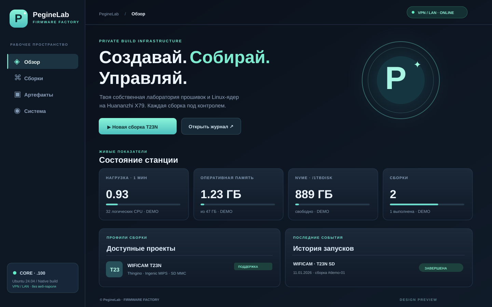
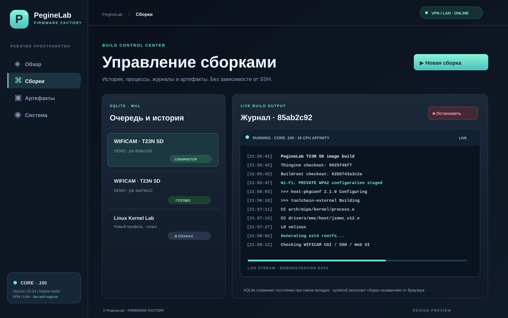

# PegineLab Firmware Factory · Ubuntu 24.04 · port 62404

**Web server:** Waitress WSGI serving a Flask API. No Nginx, Apache or Docker. Native Thingino/Buildroot builds run directly on Ubuntu ext4, while only the Python dashboard is isolated in a venv.

**Owner-specific access:** http://192.168.0.100:62404/ over the already established VPN / trusted LAN. The owner requests **no web password and no SSH tunnel**. The chosen internal IP is *not* itself an access control mechanism. Anyone who can reach that IP and port can operate builds. For general installations, allow access only through the VPN/firewall, or add an authenticated HTTPS reverse proxy. Never forward TCP 62404 to the public Internet. This repository does not modify any VPN or firewall configuration.

## Check local address and port

```bash
ip -br -4 addr
ss -ltnp '( sport = :62404 )'
```

Installation is refused if 192.168.0.100 is not assigned locally or the port is already listening. You may override the bind address using `PEGINELAB_BIND_IP` after confirming the correct trusted interface.

## Source and installation (as non-root user)

Do not switch the external WIFICAM/Thingino checkout during compilation. Camera branches and tested release `0.1_test` remain intact.

```bash
cd /1tbdisk/PegineLab/projects
git clone https://github.com/musikfed/YadroKreator.git
cd YadroKreator
bash install.sh
```

The installer creates a venv on the large NVMe, installs Flask and Waitress, runs Python tests, enables a systemd user service and linger (sudo is requested for loginctl). If missing, install `python3-venv` first. **No password is collected or stored.**

Open **http://192.168.0.100:62404/** from a VPN-connected or trusted LAN browser, without an SSH tunnel.

## Persistence and operation

State and build history live in `/1tbdisk/PegineLab/factory-state/factory.sqlite3` (SQLite WAL). Per-job logs live under `factory-state/logs/`. Transient `systemd-run --user` jobs survive SSH disconnect and browser closure. One build at a time. The dashboard shows host CPU load, RAM, disk usage, build history, logs, artifacts and checksums. Only the allowlisted `t23n_sd` profile is executable; its `PUBLISH=0` prevents GitHub publishing. Stopping a build only stops its own systemd unit.

```bash
systemctl --user status peginelab-factory.service --no-pager
systemctl --user list-units 'peginelab-t23n-*' --all
journalctl --user -u peginelab-factory.service -n 50 --no-pager
```

The app intentionally does not serve private Wi-Fi firmware images via HTTP; transfer them over SSH/SCP. Build success does not replace hardware boot and functional tests. A CORE reboot interrupts active builds without automatic resume.

## Visual design previews




These are illustrative UI mockups, **not actual running-server screenshots**.

[Русская инструкция](README_RU.md)
