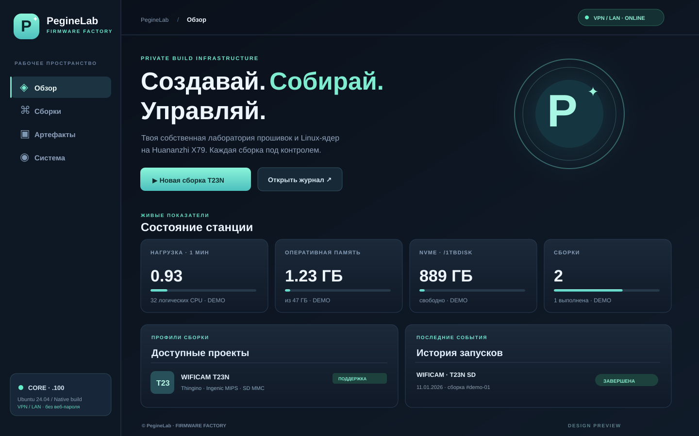
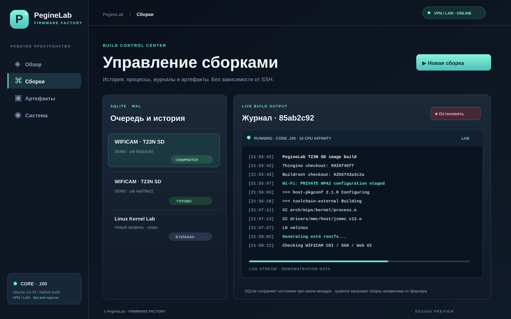

# PegineLab Firmware Factory · Ubuntu 24.04 · порт 62404

**Web server: Waitress (WSGI) → Flask API, без Nginx, Apache и Docker.** Веб-панель для CORE Huananzhi X79 (`192.168.0.100`), доступная непосредственно через VPN/LAN:

**http://192.168.0.100:62404/**

В этой конфигурации **нет страницы входа и веб-пароля** по решению владельца: доступ управляется существующей сетевой изоляцией, VPN и/или firewall. Адрес RFC1918 сам по себе не доказывает, что доступ ограничен VPN; если интерфейс доступен из локальной сети, любой её участник сможет запускать и останавливать сборки. Не пробрасывать TCP 62404 в публичный интернет. Для других установок **рекомендуется разрешать порт лишь доверенным VPN-адресам** или ставить внешний proxy с TLS и аутентификацией. Правила firewall, маршруты и VPN эта программа **не изменяет**.

## Архитектура

- Python 3.12 + Flask в отдельном `venv`, Waitress слушает только выбранный внутренний IP и порт 62404.
- Нативная сборка Thingino/Buildroot/Linux на Ubuntu/ext4. **Никаких Docker-контейнеров для компиляции.** Venv изолирует веб-приложение, не кросс-компилятор.
- Задания запускаются `systemd-run --user`, с `loginctl enable-linger` живут без SSH и открытого браузера; остановка одной задачи не затрагивает Ollama.
- SQLite с WAL и журналы в `/1tbdisk/PegineLab/factory-state/`. История и состояние переживают переход по вкладкам и рестарт UI. При перезагрузке CORE активные сборки **не возобновляются** автоматически.
- Живой журнал опрашивается раз в 2,5 с. Метрики: load average, RAM, NVMe, история, пути и SHA256. Готовые образы можно скачать одной кнопкой через веб только из разрешённой LAN; с небезопасных сетей используйте SCP.
- Текущий разрешённый профиль: `t23n_sd` (Thingino + PegineLab WIFICAM), `PUBLISH=0`, `THINGINO_FAST=0`, `THINGINO_DIR` на NVMe. Новые ядра и платы потребуют отдельных проверенных профилей.

## Проверенный SD-образ и сборки-кандидаты

Рабочая основа камеры — `wificam_T23N/Thingino/thingino-t23-sd.bin` (`0.1_test`): на реальном устройстве подтверждена **загрузка с SD**, но в старом бинарнике присутствуют дефекты веб-интерфейса. Исправления в исходниках камеры на `main` ещё требуют нового аппаратного теста.

Задания YadroKreator запускаются с `PUBLISH=0`: без Wi-Fi конфигурации образ находится в `wificam_T23N/out/candidate-sd/`, при локальном `local/wifi.env` — в `out/private-sd/`. В панели эти кандидаты явно отделены от старого эталона. Эталонный `Thingino/thingino-t23-sd.bin` при обычной сборке не перезаписывается.

**Новый сценарий:** [автоматическая загрузка исходников и деплой YadroKreator](GIT_DEPLOY_RU.md). Для каждой сборки выбирается `mymarrchWFcam` или `main`, исходники приходят с GitHub, а SHA фиксируется в отдельной рабочей папке. Устаревший checkout WIFICAM не переключается.

В разделе **Система** доступны уведомление о версии GitHub и кнопки проверки, обновления и отката на сохранённую предыдущую версию. Операции выполняются независимо от SSH через systemd, с защитой от обновления во время сборки. Автоматической установки обновлений нет; см. [Git-деплой и откат](GIT_DEPLOY_RU.md).

## Проверка перед SD и длительность сборок

В «Сборки» появились время начала, окончания, прошедшее время и примерный ETA на основе прошлых успешных заданий той же ветки. Процент — оценка по времени, не реальная доля компиляции; без истории анимация неопределённая. На готовом задании кнопка **«Проверить образ перед записью SD»** выполняет профильную проверку реального SD-файла: SHA256, T23N LBA34, BOOT FAT16/uImage, ROOTFS ext4. После неё можно открыть **SVG-схему** образа. Не производится физический тест и запись на носитель. См. [подробная проверка](PREFLIGHT_RU.md), [архитектура и дерево](ARCHITECTURE_RU.md), [как менять код и выпускать релизы](MODIFY_RELEASE_RU.md).

## Обновление с этапами и скачивание прошивки

В разделе «Система» есть индикатор: старт → GitHub → установка → зависимости → тесты → перезапуск → завершено, с автопереподключением браузера после успешного обновления. Откат доступен на предыдущий сохранённый SHA. В «Артефакты» после сборки доступно **«Скачать образ .img»**, без SSH-кода и ручного ID. По умолчанию доступ только из `192.168.0.0/24`; без персональной авторизации любой клиент этой сети может скачать встроенный Wi-Fi PSK. Защищайте LAN.

## Независимый журнал обновления панели

В разделе **Система → Обновления и восстановление** теперь отдельная консоль только для обновления самого YadroKreator, а журнал ядра/прошивки живёт исключительно во вкладке **Сборки**. При перезагрузке страницы завершённый журнал читается с конца (64 КиБ) как архив; полная историческая выдача — только по явной кнопке. При старом установщике, который завершился с ошибкой и оставил старый UI, см. [SSH-восстановление](UPDATER_RECOVERY_RU.md).

## Новое: инструкции записи образов и галерея

Для **WIFICAM T23N** полный .bin/.img записывается на SD с LBA0, а MSPL уже находится на LBA34. Для **Raspberry Pi/других SBC** нужны собственные образы и параметры загрузки. Для **Windows/Linux ISO** сначала создаётся установочная флешка, затем ОС устанавливается на SSD/NVMe. Сравнение Rufus, Etcher, Raspberry Pi Imager, GNOME Disks, типовые ошибки и проверки: [полное руководство](MEDIA_FLASHING_RU.md).

[Скриншоты панели — галерея реконструкций по пользовательским PNG](SCREENSHOTS_RU.md). Их дата и наблюдавшиеся значения подписаны, это не live-мониторинг.

## 1. Проверить IP и порт до установки

На сервере CORE (чтение, ничего не меняется):

```bash
ip -br -4 addr
ss -ltnp '( sport = :62404 )'
```

**Ожидаем:** IP `192.168.0.100` присутствует на интерфейсе сервера, порт 62404 свободен (нет `LISTEN`). Если адрес не назначен, установщик остановится; его можно переопределить через `PEGINELAB_BIND_IP=...` после проверки правильного интерфейса. Если порт занят — сначала установить владельца процесса, не отключать чужие службы.

## 2. Получить feature-ветку

Не переключать версию исходников WIFICAM/Thingino во время компиляции. Секретный `wificam_T23N/local/wifi.env` остаётся локально в проекте камеры, не публикуется.

```bash
cd /1tbdisk/PegineLab/projects
git clone https://github.com/musikfed/YadroKreator.git
cd YadroKreator
```

Ветка и исходники камеры (`wificam_T23N`) не меняются; YadroKreator — отдельный репозиторий.

## 3. Установить Web UI

```bash
cd /1tbdisk/PegineLab/projects/YadroKreator
bash install.sh
```

Установщик проверяет назначенный IP и свободный порт, создаёт venv и SQLite на NVMe, ставит Flask/Waitress, запускает тесты, включает user-service systemd и linger (разрешение sudo для `loginctl`). Если нет модуля venv: `sudo apt-get install python3-venv` и повторить. **Пароль не требуется и не запрашивается.** Слушает только `192.168.0.100:62404` (не `0.0.0.0`).

С другой машины, у которой есть доступ к этому адресу через VPN или доверенную LAN, открыть:

**http://192.168.0.100:62404/**

SSH-туннель **не нужен**. Браузер можно закрыть, сборка продолжится.

## 4. Управление

Веб-панель: Обзор → Новая сборка T23N → Сборки → Журнал → Остановить. Все изменения состояния сохраняются в SQLite. Не запускать параллельно старую ручную службу `peginelab-t23n-build.service`: UI проверяет её активность.

Команды диагностики:

```bash
systemctl --user status peginelab-factory.service --no-pager
systemctl --user list-units 'peginelab-t23n-*' --all
journalctl --user -u peginelab-factory.service -n 50 --no-pager
ss -ltnp '( sport = :62404 )'
```

Бинарник со встроенным Wi-Fi ключом остаётся только на сервере: `out/private-sd/thingino-t23-sd.bin`. Не публиковать его в GitHub и не отдавать через HTTP. Предназначен для записи **с LBA0**, с загрузчиком T23N на LBA34; после сборки необходима проверка железа.

## 5. Скриншоты / макеты




Иллюстрации — **дизайн-макеты интерфейса**, а не доказательство, что сервис уже запущен на CORE. Живые показатели появятся после установки.

## EN

[English documentation](README_EN.md)
