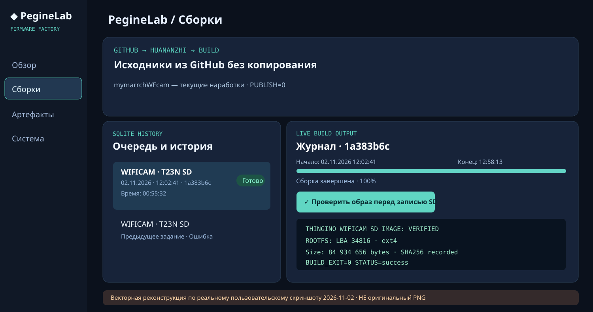
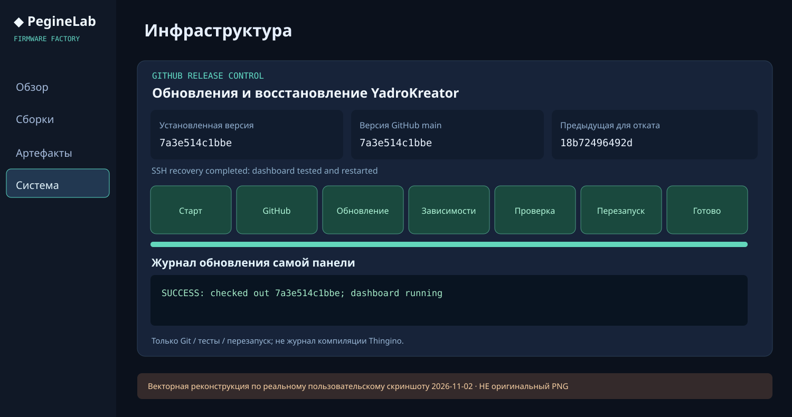

# Экранные примеры YadroKreator · 2 ноября 2026

В галерее ниже — **векторные реконструкции**, выполненные по двум скриншотам, которые пользователь прислал 2026-11-02 из работающей веб-панели Huananzhi. Это **не оригинальные PNG и не новые live-замеры**. Исходные пользовательские PNG не выкладываются автоматически в публичный GitHub, поскольку возможны локальные адреса, имена хостов и конфиденциальные пути. Для хранения исходных файлов используйте вручную проверенную/обезличенную копию.

## 1. Завершённая сборка камеры T23N

*Наблюдение по присланному скриншоту:* задание \`1a383b6c\`, ветка \`mymarrchWFcam\`, результат **Готово**, старт **02.11.2026 12:02:41**, конец **12:58:13**, длительность **00:55:32**, кнопка **«Проверить образ перед записью SD»**. Зелёный статус сборки — не гарантия физической загрузки камеры. Отдельно потребуется preflight и SD readback.

## 2. Обновление YadroKreator

*Наблюдение по присланному скриншоту:* установленная версия **\`7a3e514c1bbe\`** совпадает с GitHub \`main\`; сохранена предыдущая \`18b72496492d\`; лог **SSH recovery completed: dashboard tested and restarted**; видны семь шагов обновления и отдельный журнал самой панели. Этапы сборки Thingino должны оставаться только в разделе «Сборки».

## Где размещать исходные скриншоты (после проверки на секреты)

Если исходные скриншоты можно опубликовать, сохраните их как:

\`\`\`text
docs/screenshots/
├── build-success-2026-11-02.svg          # векторная реконструкция в GitHub
├── system-update-2026-11-02.svg          # векторная реконструкция в GitHub
├── build-success-2026-11-02.png          # оригинал, только после проверки
└── system-update-2026-11-02.png          # оригинал, только после проверки
\`\`\`

Перед публикацией **проверьте и при необходимости скройте**: пароли Wi-Fi, токены, закрытые API, SSH-ключи, персональные учётные данные, чувствительные локальные адреса или пути. Для PNG лучше делать локально копию изображения, закрывать данные *необратимо*, а не рисовать прозрачные плашки поверх текста в многослойном документе.

Снимки нужны для понимания интерфейса и инструкции; они не заменяют тесты, CI или протокол аппаратной проверки T23N.

## Использовать вместе с инструкциями

- [Запись образов на SD и диски, несколько программ](MEDIA_FLASHING_RU.md)
- [Проверка T23N SD перед записью](PREFLIGHT_RU.md)
- [Архитектура сборщика и дерево проекта](ARCHITECTURE_RU.md)
- [Графическая схема T23N](previews/t23n-sd-layout.svg)
