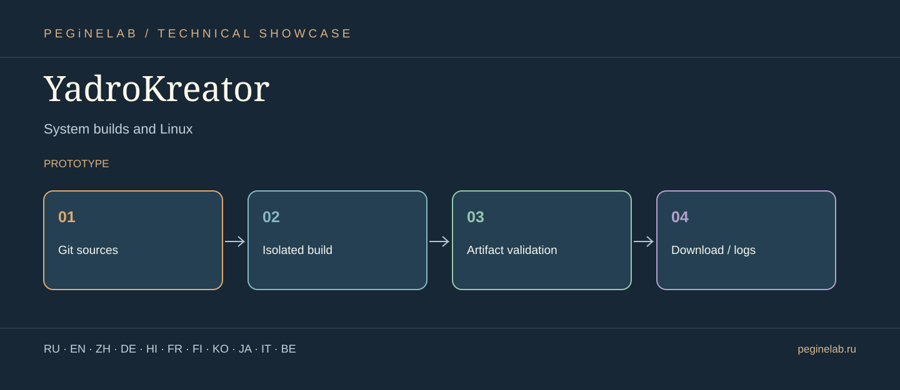

# YadroKreator · Vector showcase & translations

**Системные сборки и Linux / System builds and Linux** · **Status:** prototype.

**Document languages:** Eleven translations of the project overview. This is **not** a claim that every button, voice, or technical instruction is translated.

### Русский · ru
Панель управляемой сборки прошивок и системных образов.. **YadroKreator**: Git sources → Isolated build → Artifact validation → Download / logs.

### English · en
Controlled workbench for building firmware and system images.. **YadroKreator**: Git sources → Isolated build → Artifact validation → Download / logs.

### 简体中文 · zh
固件和系统映像的受控构建工作台。. **YadroKreator**: Git sources → Isolated build → Artifact validation → Download / logs.

### Deutsch · de
Kontrollierte Werkstatt für Firmware und Systemabbilder.. **YadroKreator**: Git sources → Isolated build → Artifact validation → Download / logs.

### हिन्दी · hi
फ़र्मवेयर और सिस्टम इमेज बनाने का नियंत्रित कार्यक्षेत्र।. **YadroKreator**: Git sources → Isolated build → Artifact validation → Download / logs.

### Français · fr
Atelier contrôlé de compilation de firmwares et d'images système.. **YadroKreator**: Git sources → Isolated build → Artifact validation → Download / logs.

### Suomi · fi
Hallittu työpöytä laiteohjelmistojen ja järjestelmäkuvien rakentamiseen.. **YadroKreator**: Git sources → Isolated build → Artifact validation → Download / logs.

### 한국어 · ko
펌웨어와 시스템 이미지 빌드를 관리하는 작업대.. **YadroKreator**: Git sources → Isolated build → Artifact validation → Download / logs.

### 日本語 · ja
システム構築と Linux. **YadroKreator**: Git sources → Isolated build → Artifact validation → Download / logs.

### Italiano · it
Build di sistema e Linux. **YadroKreator**: Git sources → Isolated build → Artifact validation → Download / logs.

### Беларуская · be
Сістэмныя зборкі і Linux. **YadroKreator**: Git sources → Isolated build → Artifact validation → Download / logs.

## Контакты · Contacts

- [Telegram @Feudorlab1](https://t.me/Feudorlab1)
- 
- [feudor.lab@yandex.ru](mailto:feudor.lab@yandex.ru) · [obzorniky@gmail.com](mailto:obzorniky@gmail.com)
- [peginelab.ru](https://peginelab.ru/) · [GitHub project](https://github.com/musikfed/YadroKreator)

The root README contains authoritative development and test status.
